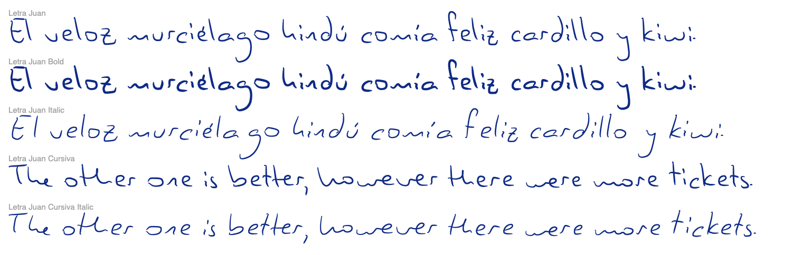
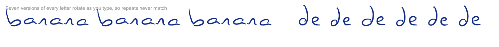
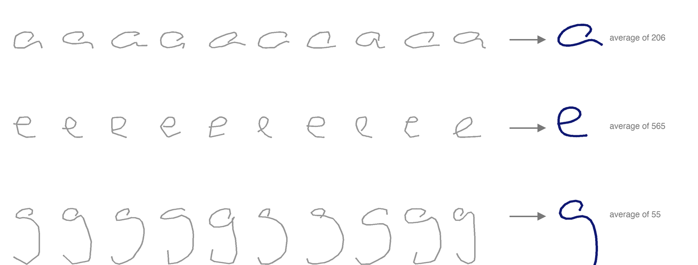
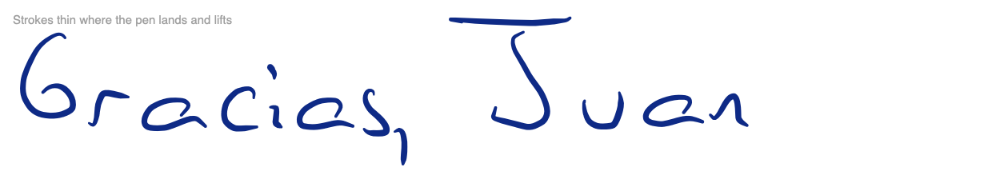
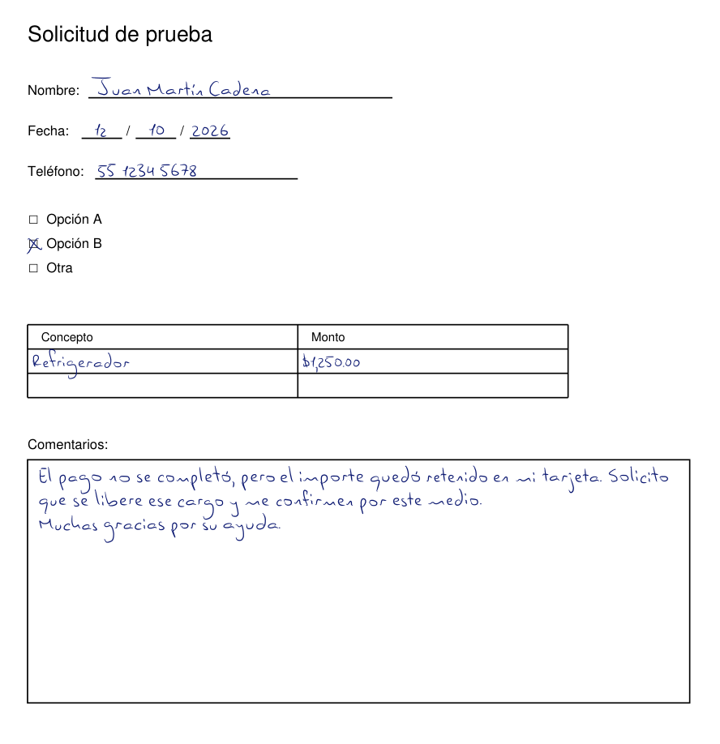
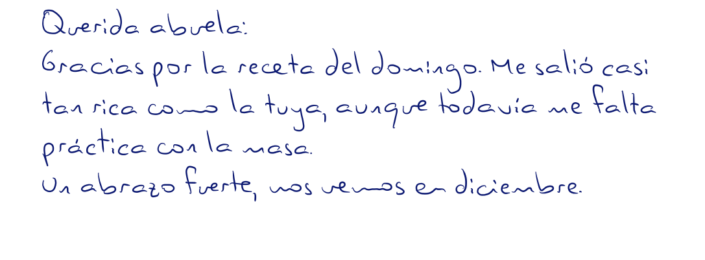

# mi-letra — my handwriting as a font

Two fonts and a PDF form filler made from my own handwriting. Nobody wrote a sample sheet: the letters come
from two years of class notes taken in Notability, which stores every pen stroke.

**Every letter has seven versions** that rotate as you type, so repeated letters never look stamped.

**Each letter is an average.** The samples of a letter are grouped by how they were drawn, and the most common
form is averaged, then blended 35% with real samples so it stays mine but reads clearly.

**Strokes follow my pen pressure:** thin where the pen lands and lifts, fuller in between.

**It fills forms.** Fields are found by their printed label; text shrinks or wraps to fit.

**And writes notes in cursive,** joining the 34 pairs of letters I usually join.

The fonts are in [`out/`](out). The images above are drawn by [`ejemplos/make.py`](ejemplos/make.py).

## How it is built

Built from the pen strokes in Juan's Notability notes. Nothing leaves this Mac.

This file is about how the handwriting is built and maintained. For using it (filling a form, writing a
note), see the `write-by-hand` skill (kept with Juan's assistant, outside this repository).

Run any script here with `uv run --with-requirements requirements.txt python3 <script>`.

## Two styles

- **Letra Juan** ("molde"): separate letters. The default, and the right one for forms.
- **Letra Juan Cursiva**: the same letters, plus 34 pairs Juan usually writes in one stroke (th, he, en, to, co…),
  swapped in automatically. `Form(pdf, style="cursiva")` uses it in the form tool.
  `pairs.py` finds and averages the pairs (`data/avg_pairs.pkl`); `pairs_check.py` drops the ones that
  hurt the read-back score (`data/pairs_ok.pkl`). Both files are frozen inputs.

Each family has four faces (Regular, Bold, Italic, Bold Italic), so an app's Bold and Italic buttons work.
Bold is a heavier pen; Italic leans the same writing to the right.

**iPhone and iPad:** `make_profile.py` packages the eight files as a configuration profile in
`~/Documents/me/Letra Juan - iPhone y iPad/` (iCloud Drive). Open it on the device and install it in Settings.

## Rebuild

`./build.sh` rebuilds everything from the frozen copy of the notes (`data/raw`) and prints
the read-back score. It does **not** install; `./build.sh install` (or `./build.sh font install`) does.

| Step | Script | Output |
|---|---|---|
| Copy strokes out of Notability | `snapshot_raw.py` | `data/raw/` |
| Cut words and letters | `extract.py` | `data/words.pkl` |
| Normalise, score letters | `bank.py` | `data/bank.pkl` |
| Second opinion (Apple Vision) | `verify.py` | `data/ocr.pkl` — frozen input, see below |
| Average each letter | `avg.py` | `data/avg.pkl` |
| Glyphs, spacing, font, PDF writing | `avgfont.py` | `out/LetraJuan.ttf` |
| Form filling | `forma.py` | |
| Checks | `measure.py read` / `gaps` | read-back score (also reported without lines the recogniser lost entirely), gap statistics |

## What must not drift

- `data/ocr.pkl` decides which samples are trusted. Re-running `verify.py` changes it and
  reshuffles the letter groups, so it is versioned and only refreshed with `./build.sh verify`.
- `data/choices.pkl` holds the approved shape of every character. `avg.py` picks the group
  closest to it and reports any character that drifted.
- `data/variants.pkl` lists, per letter, which pool samples serve as its 7 variants, most legible first. It comes from `variants.py` (ten read-back runs) and is a frozen input like `ocr.pkl`.
- `data/pick.pkl` holds the raw samples behind hand-picked characters (J, symbols, brackets).
- Juan's decisions (blend 35%, letter forms, look on forms) are recorded in `avg.py` and `avgfont.py`.

## Known weak spots

f is read as t; digits like 11 sit tight; `#`, `<`, `→` and capital I are poor.
